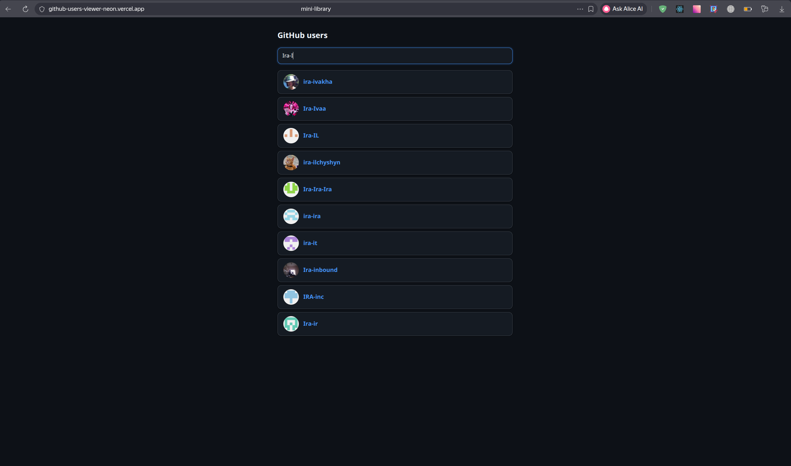
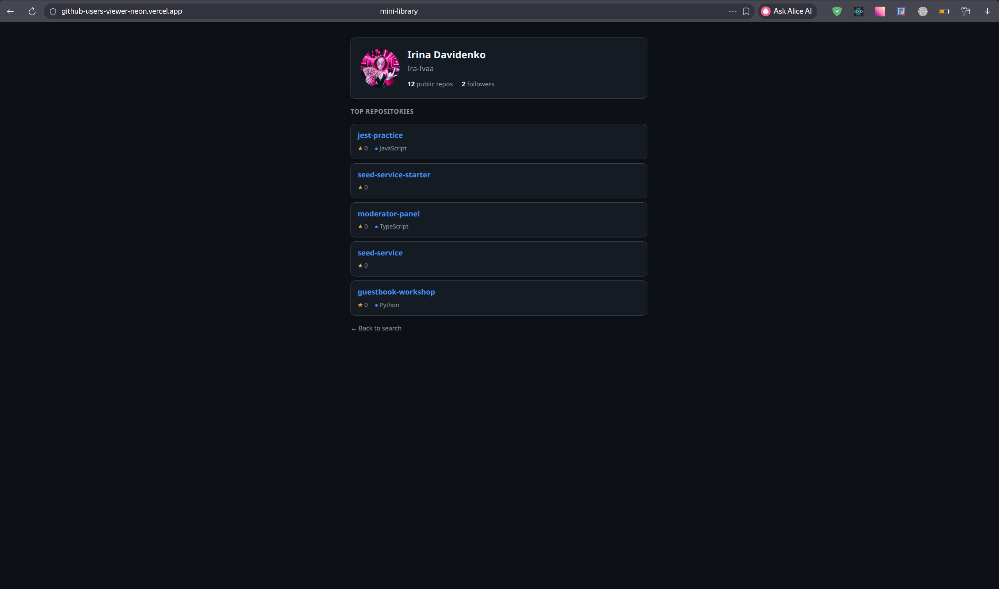

# GitHub Users

Просмотр публичных данных GitHub: поиск пользователей и страница профиля.
Данные берутся из открытого API `https://api.github.com` (без авторизации).

**Поиск пользователей** — вводите логин, и список обновляется по мере ввода:



**Профиль пользователя** — открывается по клику на логин в результатах поиска:



## Стек

React 19, TypeScript, Vite, React Router, CSS-модули.

## Запуск

```bash
npm install
npm run dev
```

Приложение откроется на http://localhost:5173

## Страницы

**`/search`** — поиск пользователей

- Поле ввода с debounce 600 мс: запрос уходит не на каждую букву
- Для каждого результата — аватар, логин и ссылка на профиль
- Состояния: загрузка, ошибка, пустой результат, результат

**`/users/:login`** — профиль пользователя

- Аватар, имя, логин, число публичных репозиториев и фолловеров
- Топ-5 репозиториев: название, звёзды, язык
- Отдельное сообщение, если пользователь не найден (404)

## Как устроено

Все запросы идут через хук `useFetch` — в компонентах нет инлайновых `fetch`.
Хук умеет:

- отменять запрос через `AbortController`, когда меняется URL или компонент
  размонтируется;
- возвращать `refetch` для кнопки «Повторить» при ошибке;
- отдавать HTTP-статус, чтобы отличить 404 от остальных ошибок.

Задержку ввода делает отдельный хук `useDebounce`.

```
src/
├── hooks/          useFetch, useDebounce
├── pages/
│   ├── searchPage/ страница поиска
│   └── userPage/   страница профиля + компоненты User и Repos
├── styles/         общие стили (shared.module.css)
└── index.css       переменные темы и базовые стили
```

Рядом с каждым компонентом лежит свой `*.module.css`. Общие блоки — карточка,
кнопка, блок ошибки — вынесены в `shared.module.css` и подключаются через
`composes`.

## Скрипты

| Команда              | Что делает                    |
| -------------------- | ----------------------------- |
| `npm run dev`        | Дев-сервер                    |
| `npm run build`      | Сборка в `dist/`              |
| `npm run preview`    | Просмотр собранной версии     |
| `npm run lint`       | Проверка ESLint               |
| `npm run format`     | Проверка форматирования       |
| `npm run format:fix` | Форматирование через Prettier |
